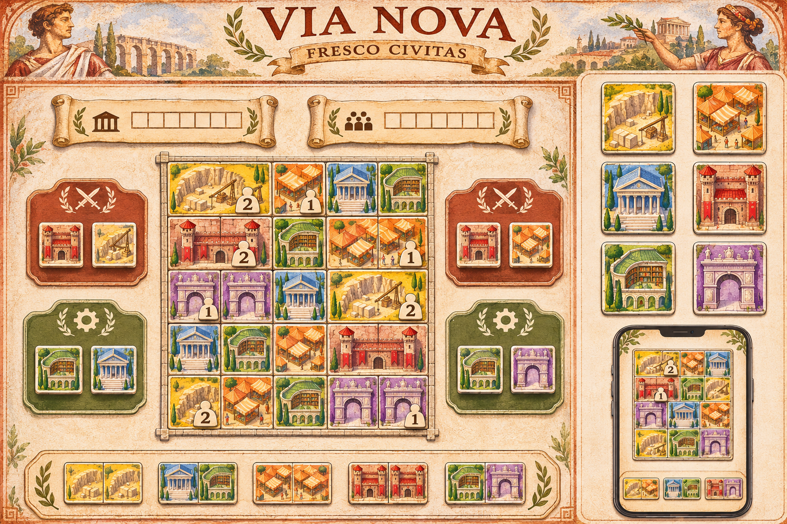
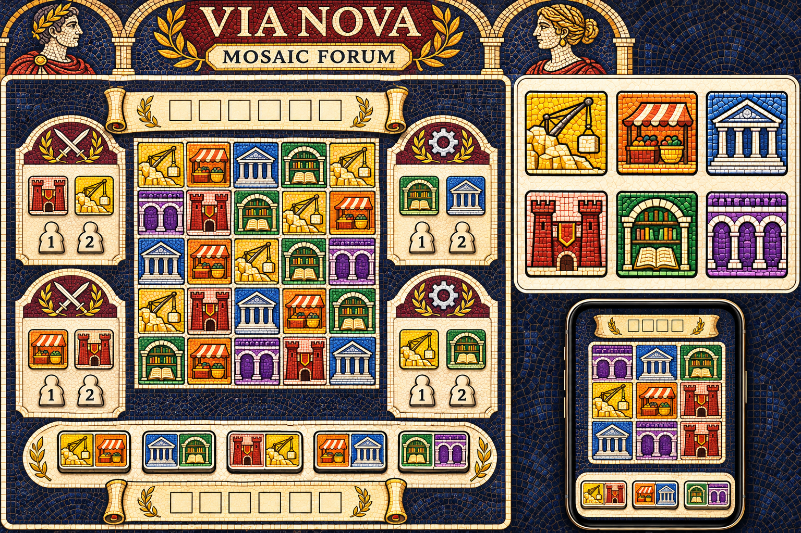
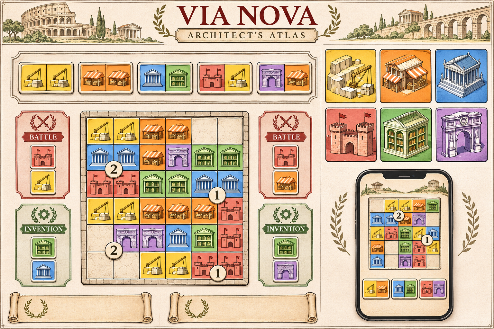

# Via Nova — Art direction proposals

**Selected direction: option 2 — Mosaic Forum.** The project owner selected the mosaic direction for the component gallery and animation lab. The three original explorations below remain as design history. Each sheet compares a city scene, enlarged building tiles, and a phone treatment. The implemented components and interactions are now awaiting review; selecting the style did not approve every detail of the generated concept sheet.

The concepts were generated with the built-in image generation tool on 2026-11-12. All three images are saved in [art/proposals](art/proposals/); the exact prompts and generation notes are in [prompts.json](art/proposals/prompts.json). They explore visual language rather than reproduce the supplied PDF's illustrations.

## Shared visual requirements

The style must support a city assembled from square spaces on dominos and single rebuild tiles. Preserve the rulebook's building colors: **yellow Quarry, orange Market, blue Temple, red Barracks, green Library, purple Arch**. The designer’s symbols are primary identifiers: pickaxe, amphora, pedestal, crossed swords, open book, and arched gateway. The exact same symbol must be shown on each building and wherever a scroll, banner or action refers to that type. Colour supports these symbols. Keep player ownership separate through colored bases, seat symbols, and labels.

Use clear Arabic 1 and 2 numerals for population. Reserve quiet, high-contrast panels for scoring, double-domino marks, + stacks, and Arch 3 or 2 2 2 marks. Scroll and banner shapes must remain distinguishable at phone scale. The player should recognize a building before studying its illustration.

All concepts need the same functional layers: building art, square boundary, domino grouping, scoring panel, action marks, ownership, and selection/preview overlays. Use generated, rich raster artwork for physical pieces, boards, material and illustrations; build geometry, rules symbols, labels, numbers, and highlights as crisp interface elements. A flattened concept image must never become the game board.

## 1. Fresco Civitas

**Character:** warm, inviting Roman civic life. Painted plaster, mineral pigments, terracotta roofs, and small illustrated architectural details give each city a handmade board-game presence.

**Treatment:** shallow isometric gouache buildings sit inside top-down square spaces. Ivory panels, dark umber type, rust Battle trays, and sage Invention trays create a calm frame. Suggested interface palette: plaster `#F4E7CE`, umber `#3C2A20`, terracotta `#A64B35`; retain the six functional building colors independently.

**Typography and motion:** a restrained inscription-inspired serif for titles, a highly legible sans serif for rules and values. Tiles settle with a short soft movement; rebuilds lift and replace a layer; action highlights use a brief painted-edge glow.

**Device fit:** gives a large tabletop warmth and a strong sense of place. Phones need simplified crops, stronger color fields, and less plaster texture than the sheet. Decorative portraits and borders belong on the entrance or loading screen, leaving gameplay space to the cities.

**Production cost and risk:** the most illustration-heavy direction. Small scenes can lose silhouette clarity and make yellow/orange or red/orange hard to distinguish. Commission or generate six consistent master buildings before expanding variants; keep symbol panels texture-free.

**Choose this if:** the priority is a welcoming illustrated board game with a rich Roman atmosphere.

## 2. Mosaic Forum

**Character:** bold geometric Roman mosaic. Large tesserae, architectural emblems, and mineral jewel colors give the game a distinctive ornamental identity.

**Treatment:** chunky building silhouettes and dark outlines sit against ivory grout. Midnight stone frames the table; cream panels separate controls from decoration. Suggested interface palette: midnight `#192D42`, limestone `#F2E3BF`, antique gold `#C99A3A`. The six building families retain their functional hues.

**Typography and motion:** sturdy serif display headings, plain sans serif labels. A tile drops into a socket; selected borders brighten as one continuous outline. Avoid shimmering individual tesserae, which would compete with legal-move highlights.

**Device fit:** strong emblems are recognizable across a tabletop and at small sizes. Phone tiles should use fewer, larger tesserae. Dark surrounds may work well in a dim room; bright-device testing must ensure that shadows and dark outlines do not swallow tile boundaries.

**Production cost and risk:** medium illustration effort, with strict consistency needed for tessera size and grout. The supplied sheet is too textured for final play and does not sufficiently distinguish the Invention areas by their frame treatment. Keep mosaic texture inside artwork and decorative margins; use plain scoring plaques and differentiated contest headings.

**Choose this if:** the priority is an unmistakable Roman visual identity with bold, symbolic components.

## 3. Architect's Atlas

**Character:** a clear, contemporary city-planning atlas with Roman architectural drawings. Warm paper, fine charcoal contours, broad building colors, and generous spacing emphasize the placement puzzle.

**Treatment:** concise architectural emblems at normal scale, with detailed axonometric illustrations reserved for inspection and larger tiles. Suggested interface palette: warm paper `#F7F1E3`, charcoal `#30332F`, muted bronze `#977A4B`. Keep color fields more uniform and the paper texture lighter than in the generated sheet.

**Typography and motion:** a modest classical serif for the title and a humanist sans serif for controls and scoring. Preview placements with a clean ghost outline, trace matching edges, then show actions in an ordered strip. Rebuild motion exposes the replaced layer briefly without hiding the result.

**Device fit:** strongest starting point for small phone screens, keyboard focus, scoring overlays, and large late-game cities. Clear square boundaries and plain panels also suit a touch table viewed from multiple edges. Keep city growth unbounded by the decorative rectangular frame shown in the concept.

**Production cost and risk:** lowest expected illustration complexity and easiest to turn into a consistent component system. It can feel sparse without careful spacing and a few warm architectural details. The generated sheet remains more decorative than the intended production treatment; reducing borders will be part of the next pass.

**Choose this if:** the priority is spatial clarity across all four device categories.

## Comparison and recommendation

These are design judgments to validate in the component prototype, not measured usability results.

| Criterion | Fresco Civitas | Mosaic Forum | Architect's Atlas |
| --- | --- | --- | --- |
| Roman atmosphere | Warm, scenic | Strong, ornamental | Quiet, architectural |
| Phone readability potential | Good after simplification | Good with coarse tesserae | Strongest starting point |
| Shared-table presence | Rich and tactile | Bold and graphic | Calm and precise |
| Main risk | Illustration detail competes with symbols | Texture competes with boundaries | Too restrained or sparse |
| Relative production effort | High | Medium | Low to medium |

**Decision: Mosaic Forum.** Use its architectural emblems, mineral colors, dark outlines, ivory components, and navy surround. The first production-facing treatment uses original SVG mosaic buildings with tessera texture inside the artwork and crisp independent rules symbols. Review the actual components at `/gallery/` and their composition at `/dev/animations/`; the generated sheet is visual inspiration, not the interface specification.

## What the sheets do not approve

The generated scenes contain illustrative shortcuts. Population pieces appear on city tiles in some sheets; actual population belongs in reserve, on player boards, or in shared areas. The sheets omit or simplify scoring plaques, Arch action marks, double-domino marks, stacked rewards, and multiple players' cities. Mosaic Forum mischaracterizes the Invention frames. Blank scroll-like strips are composition placeholders, not new score tracks or components. The pictures do not establish legal positions, historical accuracy, a finite city boundary, or a complete tabletop layout.

The phone inset is a personal-screen concept and may show its owner's hand. A shared tabletop must keep unplayed hands on paired private devices. Full seat layouts and privacy interactions need their own functional review after style approval.

## Approval and next review

Option 2 is selected. The next approval concerns the actual component collection, responsive layouts, and action interactions described in [docs/PRESENTATION.md](docs/PRESENTATION.md), before implementing the ruleset.

The component gallery and animation lab now provide the following review samples before producing the complete tile-face manifest:

1. All six buildings at phone and tabletop sizes, including a marked domino and both Arch activations.
2. A rebuild with a scroll, one with a banner, and a two-tile + reward stack with both scoring panels visible.
3. Four player ownership treatments, 1/2 population pieces, and a contest with a tie and two rewards.
4. A late-game city with matching-edge previews, 3×3 scroll highlights, and row/column banner highlights across gaps.
5. Phone portrait/landscape, laptop, tablet, and four-seat tabletop views using those same components.

Review contrast, touch targets, color-independent recognition, symbol legibility, reduced motion, and actual tabletop viewing distance. Record the selected palette, font licenses, asset provenance, and any permissions for source materials before distributing production assets.

## Production mosaic pass · 12 November 2026

The initial markup illustration pass was rejected as insufficiently tactile. The replacement uses fourteen built-in imagegen assets: six coordinated stone mosaic building faces, a navy mosaic reverse, transparent rolled-scroll and tabbed-banner plaques, a transparent carved wooden meeple, two shared board substrates, a player mat and a recessed stone tray. Runtime layers are in [static/assets/mosaic](static/assets/mosaic/); exact briefs and original-generation provenance are in [art/mosaic/prompts.json](art/mosaic/prompts.json). The assets are optimized display derivatives; the original generation locations are recorded in the prompt ledger. No commissioned/source print illustrations were copied into the game art.

The composition follows Pantheon’s art/material/live-ink separation and Hanami’s painted pieces with precise overlaid affordances. Richness belongs to physical form and broad material; it must not compete with icon recognition. The shared vector symbols deliberately follow the print-and-play semantics instead of miniature artwork or emoji. Scoring shape and footprint remain recognizable without colour; family ink supplies a supporting building cue. Generated artwork is for review; aesthetic and icon recognition approval remains with the designer and project owner.

Minimum-use briefs: building faces 96 px square; scoring plaques 94×36 px with 24 px target symbols; population 44×52 px interactive; boards roughly 340 px wide with locally panning reward areas. The gallery uses larger 128 px specimens but production routes retain the same layers. Review at actual phone/tabletop size and in grayscale before approval. Native hardware and viewing-distance review is still needed.

## Layer registration pass

The shared tile assembly now has a registration editor at `/dev/layers/`, backed by [one checked-in configuration](src/lib/presentation/tile-registration.json). Emblems have face-specific offsets; scoring material and ink are independently registered by shape. The scoring plaque’s generated border is nine-sliced to preserve a usable ink opening instead of vertically stretching ornament into it. Scoring ink is one scalable SVG group; family symbol viewBoxes remove internal whitespace, and starting letters/Arch values use explicit text canvases. Actual-size comparisons and exploded/isolated inspection use the exact shared production component. Existing PNG assets are unchanged.

This pass corrects alignment and exposes remaining image constraints for review. The underlying face still combines illustration, rim and reserved regions in one bitmap; separating those features would require new artwork layers. Applied authoring overrides are browser-local; approved JSON exports become the shipped source configuration.

## Owner-supplied calibration · 13 November 2026

Apply the corrected Library geometry across all tiles: emblems at x=5%, y=5%, width=15%, height=15%; scroll and banner material at x=0%, y=74%, width=100%, height=26%; ink at x=25%, y=78%, width=55%, height=20%. These supplied proportions replace the first-pass registration and size targets above. All other supplied marks and artwork transforms are retained. Refreshed actual-size gallery/game captures document this common layout. Browser appearance overrides are scoped to the shipped calibration, so older locally saved layouts do not mask the refreshed preview.

## Scoring recognition pass · 13 November 2026

Banners now use [a generated hanging cloth asset](static/assets/mosaic/score-banner-v2.png) with a visible top rod, broad folded shoulders and deep pointed tails. Its whole alpha silhouette is rendered at the approved coordinates, rather than compressing decorative tabs through nine-slice borders. A quiet dark stone recess behind the mounted banner preserves negative space against pale tile artwork. Scrolls retain rolled ends and the existing generated material. Banner-target and pair glyphs repeat the cloth’s pointed-tail silhouette. The old banner image remains as provenance, but the shared renderer uses v2. Exact built-in imagegen edit prompt and source provenance: [banner-v2.json](art/mosaic/banner-v2.json).

Building emblems and building-target scoring symbols share family inks: ochre Quarry, burnt-orange Market, lapis Temple, brick-red Barracks, green Library and violet Arch. The palette is defined once as `buildingInfo.symbolColor`, with darker values for contrast on ivory. Numerals, footprints and non-building targets remain neutral. Every building keeps its distinct silhouette, and every scoring shape keeps its footprint cue. The grayscale gallery review remains available. The owner-supplied positions and sizes are unchanged.

VP recognition refinement: the shared scoring ink now includes a muted gold vector laurel around/behind the live VP numeral, keeping the number dark and its size unchanged. Both scrolls and banners use this cue, including fixed VP awards. Banner ink moves down from y=78% to y=79.5% of the tile to sit on the cloth field; scroll ink and all material bounds stay unchanged. This adjustment is in the editable production registration, including standalone gallery plaques. Actual-size colour/grayscale and phone captures accompany this revision; physical viewing-distance approval remains outstanding.

Action-value recognition: shared `ActionValue.svelte` frames each action number as a square stone building tile, with a restrained lintel and dark live numeral. Arch tiles and the generated action queue use exactly this component. The single Arch’s three sequential building actions each have their own framed 2; VP values retain the contrasting laurel. Registered tile bounds and controller semantics are unchanged. Phone and tabletop captures show the same shared treatment.
