# Review evidence

Current captures from the actual shared Svelte components after the generated mosaic artwork, full v56 inventory and interaction-controller cleanup. `bun run verify` passes: zero Svelte errors/warnings, 34 unit tests, 28 Chromium browser journeys and the static build. Screenshots establish rendered evidence; they do not establish designer approval or human icon recognition. Phone/tablet/tabletop hardware review remains outstanding.

The current tile captures use the owner-supplied Library calibration generalized to all six families and both scoring shapes: 15% emblems at (5%,5%), lower scoring material (0%,74%,100%,26%), and ink (25%,78%,55%,20%). Other supplied marks are retained. Stored settings from earlier calibration revisions no longer mask newly shipped defaults.

The scoring recognition pass adds a generated cloth banner with a dark recess to show its cutouts on pale tiles, and matching family inks on building emblems and scoring targets. Registration coordinates remain the supplied calibration. Scroll and banner shapes, their footprints and building silhouettes remain independently recognizable in grayscale.

## Tile registration

The `/dev/layers/` route renders the actual shared tile assembly. It provides direct drag/keyboard/numeric edits, per-layer visibility/isolation, exploded stacking, real-size comparison, undo/redo, recoverable drafts, browser-wide application and portable JSON export.

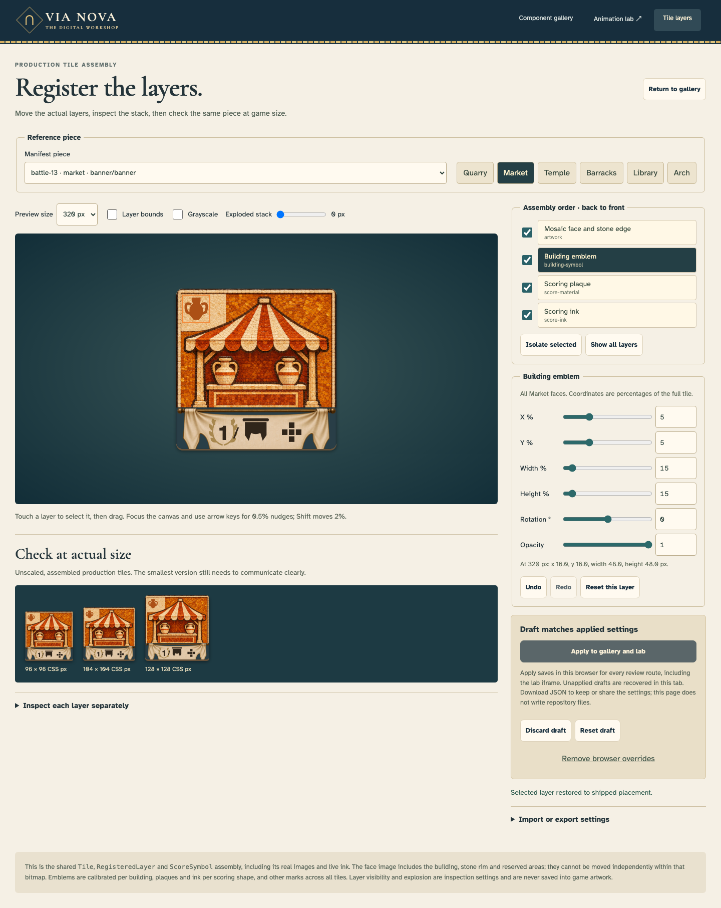

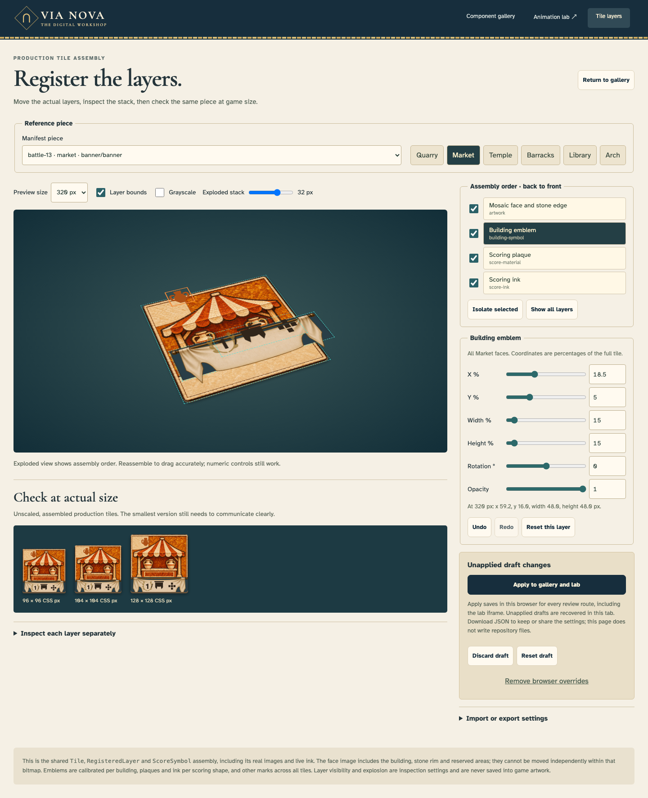

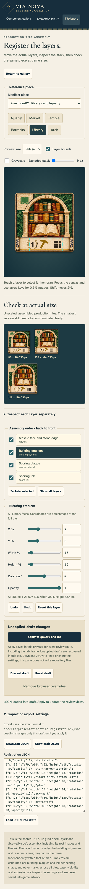

Scoring ink follows one registered SVG canvas with separate rolled-scroll and hanging-cloth materials; emblem geometry is independently calibrated per family. Applied geometry updates the already-open gallery and animation iframe. These captures are inspection evidence, not designer approval.

## Layered physical pieces

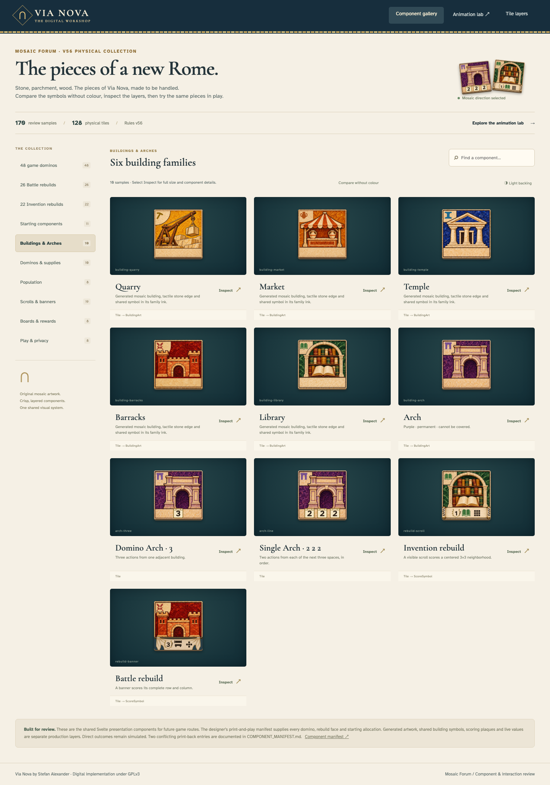

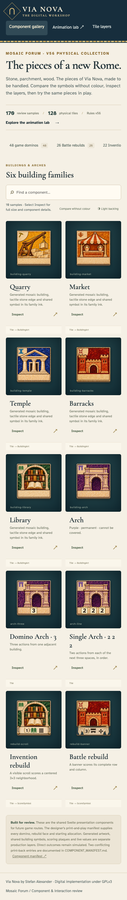

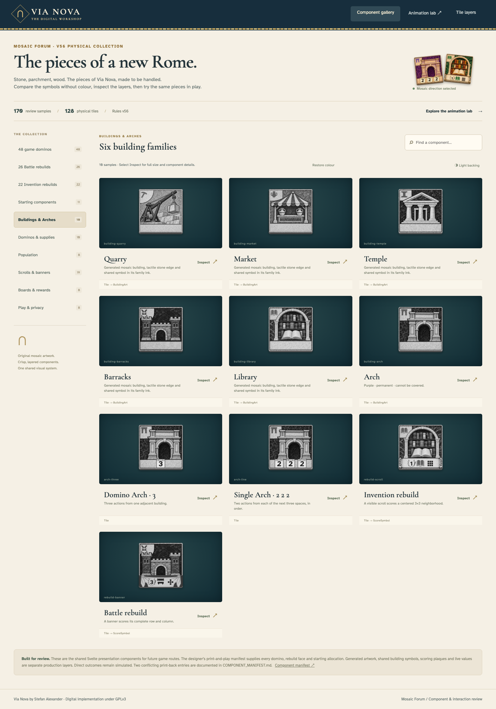

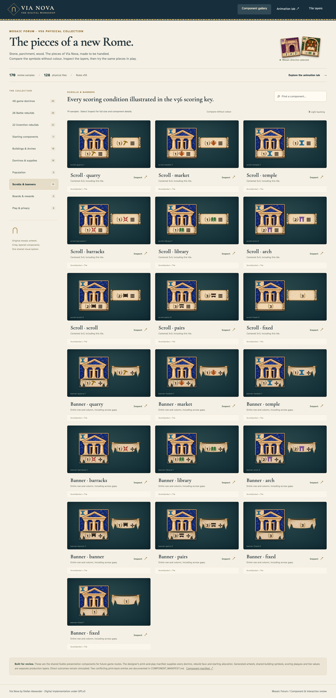

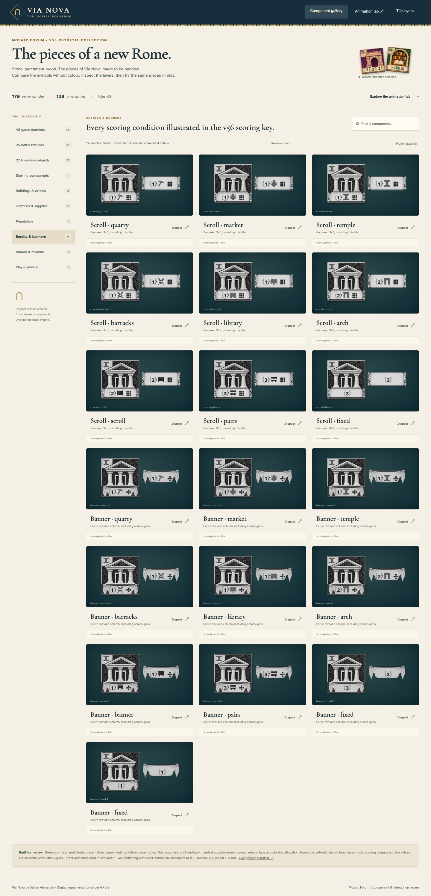

## Same pieces in game compositions

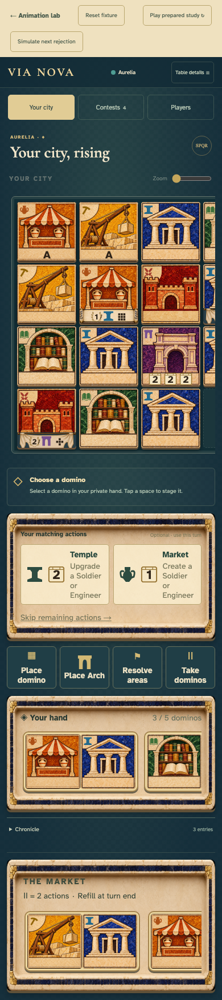

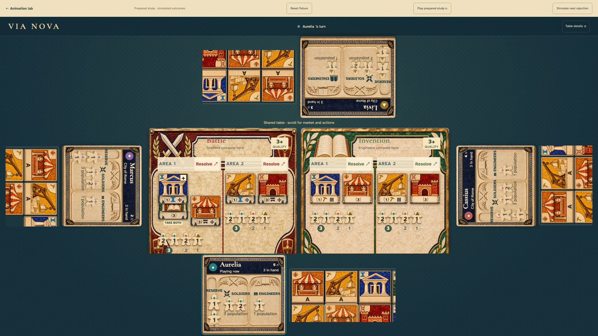

The tabletop keeps 96–104 px pieces and pans city windows, reserve wells and the central shared region locally instead of shrinking scoring symbols. The visible scroll hint leads to the market and actions. These layout choices still need physical-device review.

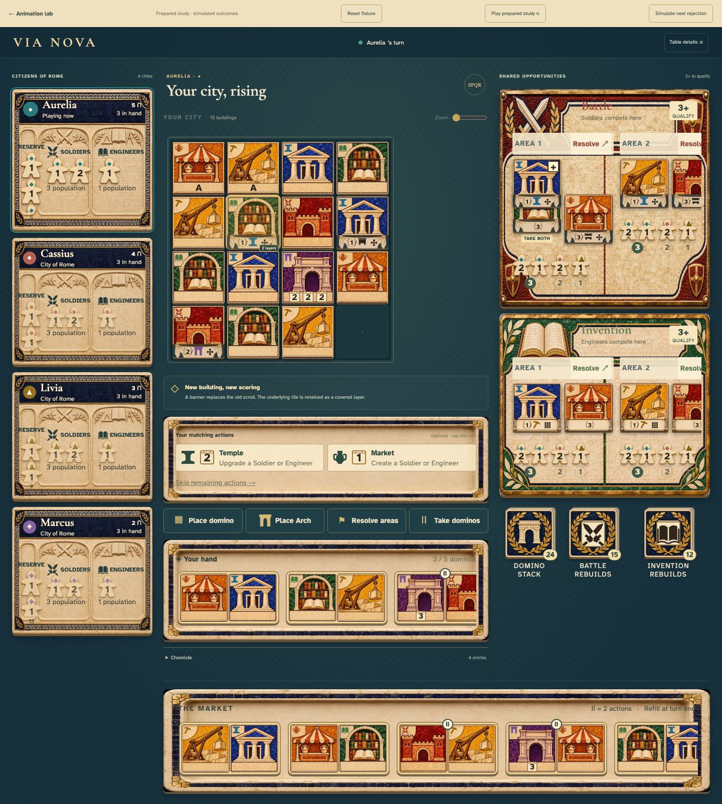

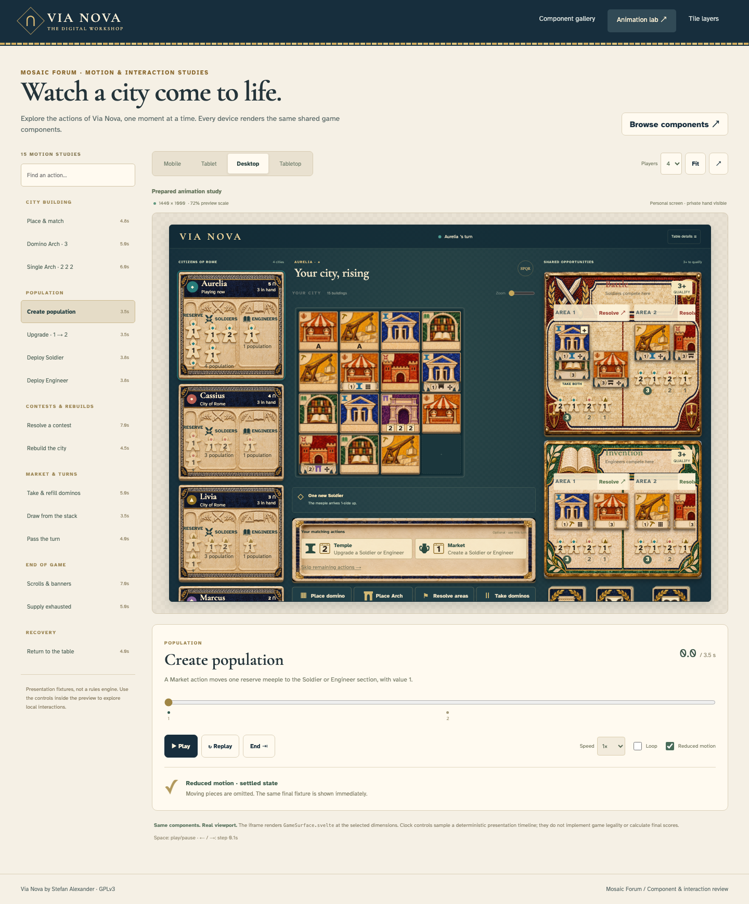

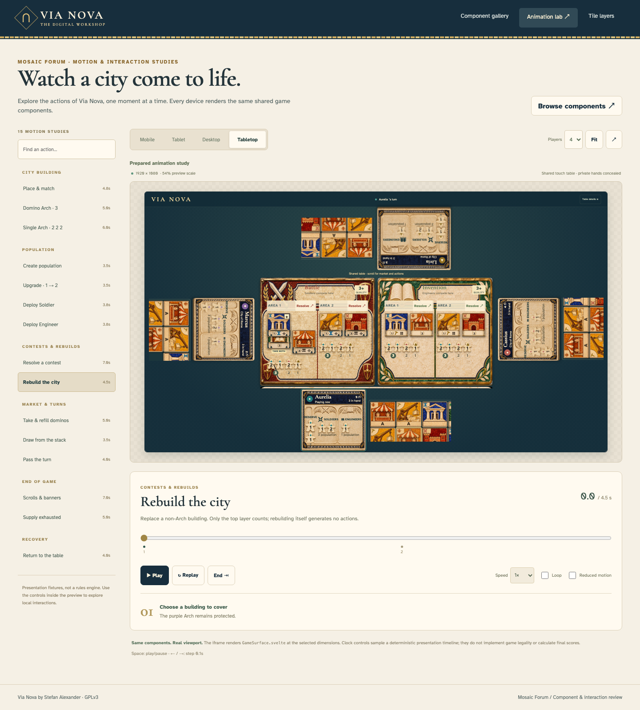

## Object-specific interaction states

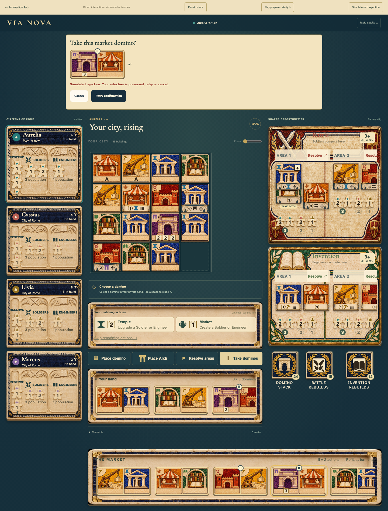

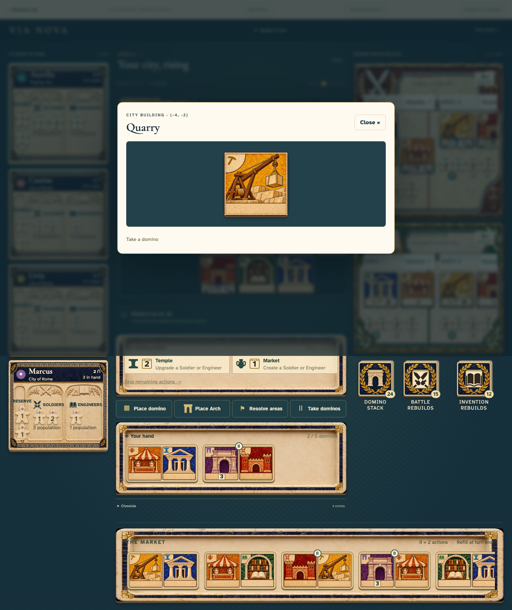

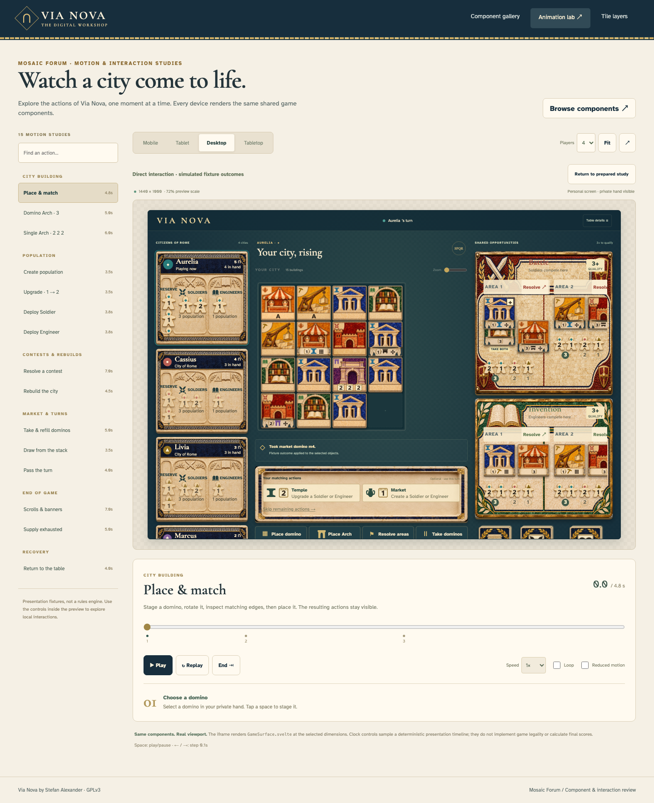

All outcomes are simulated through the fixture adapter; no rules authority or multiplayer service is implemented. The browser suite also captures phone landscape and tablet layouts under `test-results/review/`; CI uploads the complete report and failure traces. See [the integration boundary](../PRESENTATION.md), [component manifest](../../COMPONENT_MANIFEST.md) and [artwork prompt ledger](../../art/mosaic/prompts.json).

VP recognition refinement: the shared scoring ink now includes a muted gold vector laurel around/behind the live VP numeral, keeping the number dark and its size unchanged. Both scrolls and banners use this cue, including fixed VP awards. Banner ink moves down from y=78% to y=79.5% of the tile to sit on the cloth field; scroll ink and all material bounds stay unchanged. This adjustment is in the editable production registration, including standalone gallery plaques. Actual-size colour/grayscale and phone captures accompany this revision; physical viewing-distance approval remains outstanding.

Action-value recognition: shared `ActionValue.svelte` frames each action number as a square stone building tile, with a restrained lintel and dark live numeral. Arch tiles and the generated action queue use exactly this component. The single Arch’s three sequential building actions each have their own framed 2; VP values retain the contrasting laurel. Registered tile bounds and controller semantics are unchanged. Phone and tabletop captures show the same shared treatment.
